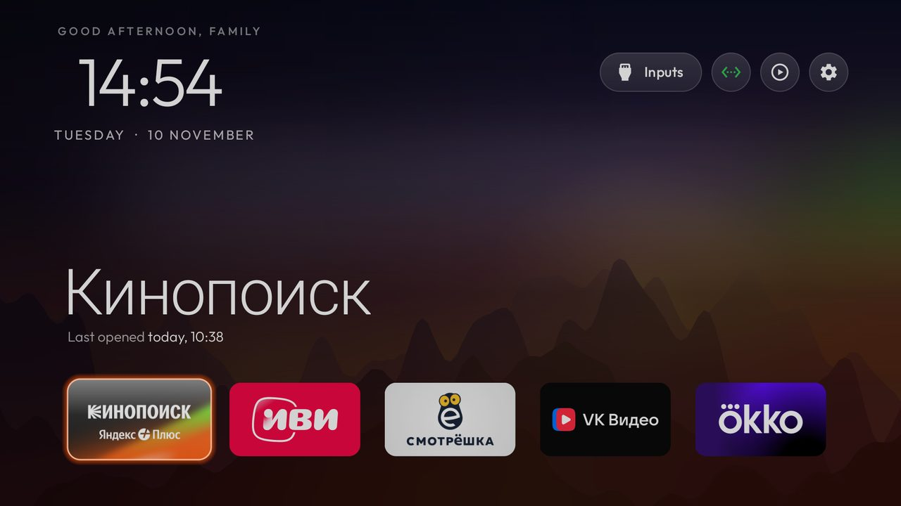
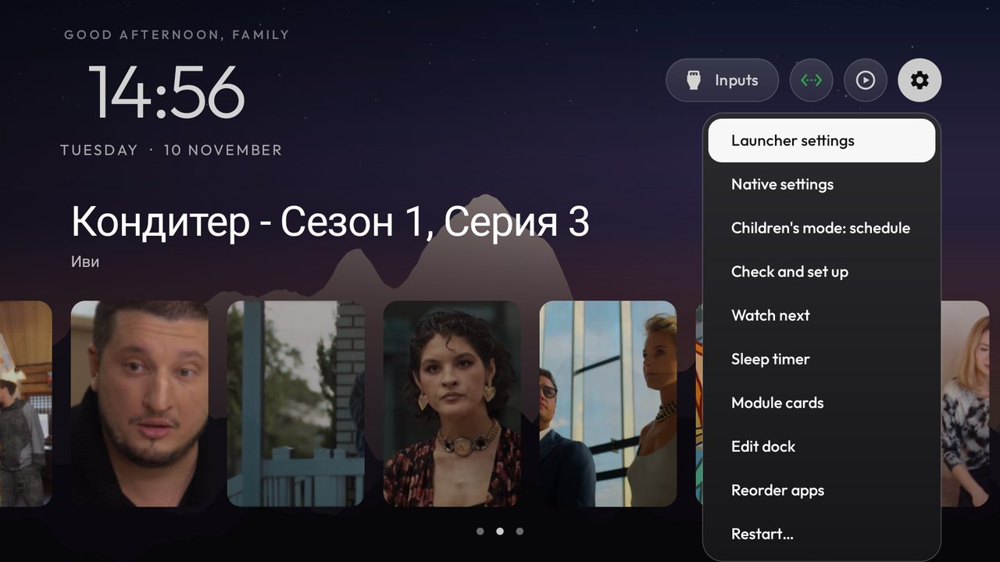
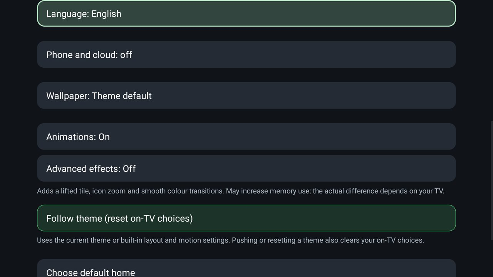

# MyTV

**A slow Android TV made fast, and a home screen where parents set the rules.** MyTV is a free, open-source launcher
(MIT) for Android TV and Google TV, under 1 MB, with no account, no analytics and no ads. [Project page](https://tv.secondoffice.ru)
· [Download MyTV.apk](https://github.com/iResultMan/MyTV-launcher/releases/latest/download/MyTV.apk)
· [Install from a computer](https://tv.secondoffice.ru/#install) · [По-русски](https://tv.secondoffice.ru/ru/)

<p align="center">
  
</p>

## Why the TV gets faster

A slow TV is rarely slow only because of its chip. On our TCL the memory was full nearly all the time: the 600 MB swap was
almost always used, and with five heavy apps open the system's memory cleaner took 95% of a core. MyTV goes after that:

| What | How |
|---|---|
| **Services you never use are switched off** | The install tools disable the manufacturer's telemetry, ad services, content rows and preloaded apps with `pm disable-user`. Nothing is uninstalled and one command puts everything back. [`examples/`](examples/) has lists for 250+ TV models; on our TCL it came to 15 packages. |
| **A launcher that does almost nothing while idle** | It draws only when something changes. Measured on one TCL TV (version 2.7): 42 MB and 0 to 0.6% of a core while idle; two other launchers held 64 MB and 140 MB and used about 13% and 30 to 58%. One TV, a few runs; we will measure the current version again. |
| **A sanitizer that tidies the TV by itself** | Nothing polls. It looks at memory when Home has been quiet for three minutes, when the screen goes off and when Android asks apps to give memory back. If swap is nearly full or RAM is low it closes background processes of your apps (never the one on screen, one playing, the launcher or your VPN app), at most once in 20 minutes, and it reopens a dropped VPN app after four quiet minutes. One setting turns it off. Still being tried on one TV. |

## What a family gets

| Feature | What it does |
|---|---|
| **Children's mode** | A schedule for when the TV may be used, a PIN stored as a salted hash, a journal, a daily screen-time table for 30 days and bonus minutes a parent grants with the PIN. |
| **Phone control at home** | The TV shows a pairing code; a parent's phone gets a small page served by the TV itself, inside your home network only. Lock, unlock, send a message over the video, power off. Each phone has its own revocable token; scripts and bots use the same documented HTTP API ([docs/REMOTE.md](docs/REMOTE.md)). |
| **Sleep timer over the video** | Up and Down change the minutes (off, 15, 30, 60, 90) while the video plays. A warning shows a minute before, any key adds 15 minutes, then the TV goes to standby. A second double tap of the gear button shows the time left and the arrows round it to the next choice. On a TCL remote a double tap of the gear button opens it. |
| **Watch next first** | Home opens on the shelf of films and episodes you were in the middle of; the apps are one press down. |
| **Power off from the phone** | Now or after a delay of up to 24 hours, and cancel a pending one. |
| **A way out of a stuck lock** | If the PIN is lost, a marker file sent over adb lifts the lock. Nothing else can. |
| **Weather block, 31 languages, themes, Clock screensaver, app library** | Settings in [docs/launcher.md](docs/launcher.md). |

The speed is the reason; these are the family features on top of it.

<p align="center">
  
  
</p>

## What is tested, and what is not

Tested on a real TCL BeyondTV2: children's lock and unlock, the usage tables, the sleep timer (warning, +15 minutes, standby,
wake by remote), power off with a delay and cancel, the phone page and pairing on a home network, the weather block and the
Watch next shelf. **Still being tried on that one TV:** the sanitizer and the VPN restart, the children's schedule, the phone
page's power-off button, and switching the TV off by voice through HDMI-CEC. Translations other than English, Russian and
Hebrew fall back to English. Needs Android 8.0 or newer (standby needs Android 9).

## Install

You need a computer on the same Wi-Fi as the TV and about ten minutes.

1. **On the TV:** Settings → Device Preferences → About → press OK on **Build** seven times → back → Developer options →
   **USB debugging** on (and Network debugging if offered). Note the TV's IP under Settings → Network.
2. **On the computer:** install Google's platform-tools (they contain `adb`), then `adb connect 192.168.1.50:5555` with your
   TV's address, and allow the connection on the TV.
3. **Put MyTV on the TV:** download [MyTV.apk](https://github.com/iResultMan/MyTV-launcher/releases/latest/download/MyTV.apk)
   and run `adb install -r MyTV.apk`. If another build with the same application id (`com.gathin.tvhome`) is on the TV,
   uninstall it first: Android will not replace an app signed by someone else.
4. **Make it Home and switch the rest off:** the guided path below does the backup, applies the list of services for your TV
   model, makes MyTV the home screen and rolls back if Home does not land on it.

A one-click installer for Windows, macOS and Linux is planned.

## Supported TVs

Anything running **Android TV** or **Google TV**. Fire TV gets the debloat half only (Fire OS will not hand Home to a
third-party launcher); a few China-market TCL sets refuse any launcher; Samsung (Tizen), LG (webOS), Roku, Vizio and Hisense
VIDAA have no ADB and are not supported ([what a 2021 Samsung set answers](docs/devices/samsung-tizen.md)). Tested lists, one folder per model: [`examples/`](examples/), full table in
[examples/README.md](examples/README.md). Your TV not there? [CONTRIBUTING.md](CONTRIBUTING.md) has the format.

## Doing it by hand

This is the whole install, run by you. Two things have to be on the computer first:

| You need | For |
|---|---|
| **Python 3** (any 3.x) | The tools. The venv command below installs what they import. |
| **JDK 17 through 22** (a full JDK, including `jlink`) and **Android SDK platform 34** with **build-tools 34.0.0 or any newer 34.x** | Building the launcher. JDK 23 and newer stops Gradle 8.9. Platform 34 is the one the build reads; a newer platform does not replace it. On macOS, when none of these is installed: `brew install openjdk@17 android-commandlinetools`, then `sdkmanager "platforms;android-34" "build-tools;34.0.0"`. On Linux the install script looks in `~/Android/Sdk` and for `java` on your PATH. |

`tools/tv.py` talks to network ADB on port 5555. If that port stays closed and the TV offers
Wireless debugging with a pairing code (the Chromecast with Google TV and the Google TV Streamer
do), pair it once with the stock `adb`. Then either run `adb tcpip 5555` to open the port, which
usually lasts only until the TV reboots, or keep it closed: point `TV_ADB_BINARY` at that same
`adb` and `TV_HOST` at the port the Wireless debugging screen shows, and the tools reach the TV
through the paired connection with nothing listening on 5555
([tools/native-adb.md](tools/native-adb.md)). [Troubleshooting](docs/TROUBLESHOOTING.md#connecting)
has both, with the pairing steps.

```bash
python3 -m venv tools/venv && tools/venv/bin/pip install -r tools/requirements.txt
export TV_HOST=192.168.1.50                                   # your TV's IP address

tools/venv/bin/python -I tools/tv.py --probe                 # model, Android version, firmware
tools/venv/bin/python -I tools/tv.py 'pm list packages'      # one shell command on the TV
tools/disable.sh examples/xiaomi-mi-tv-4a/debloat.txt        # apply a debloat list
tools/restore.sh examples/xiaomi-mi-tv-4a/debloat.txt        # undo it, stock launcher back
tools/venv/bin/python -I tools/check.py examples/xiaomi-mi-tv-4a/debloat.txt   # what a firmware update undid
TV_HOST=192.168.1.50 launcher/build-and-install.sh           # build the launcher and make it Home
tools/theme.sh themes/aurora                                 # push a theme; --reset removes it
```

| Tool | What it does |
|---|---|
| [`tools/tv.py`](tools/tv.py) | Pure-Python ADB client: shell, batch, push, pull, reboot, and screenshots, optionally pressing remote keys first. Works where the stock `adb` binary is blocked. Optional [paired Google ADB backend](tools/native-adb.md) for encrypted Wireless debugging. |
| [`tools/docker-build.sh`](tools/docker-build.sh) | Builds the launcher or an add-on in Docker (JDK 17, Android SDK 34), so this computer needs nothing but Docker. Install the result with `SKIP_BUILD=1`. [Guide](tools/docker-build.md). |
| [`tools/b64push.py`](tools/b64push.py) | Uploads large files such as APKs in base64 chunks and verifies the checksum. |
| [`tools/relay.py`](tools/relay.py) | Forwards a local port to the TV's ADB port, for tools whose sandbox can't reach your network. Listens on this computer only. [Guide](tools/relay.md). |
| [`tools/disable.sh`](tools/disable.sh), [`restore.sh`](tools/restore.sh) | Apply or undo a debloat list, the undo from the state recorded before the change. |
| [`tools/recovery.py`](tools/recovery.py) | Writes the record `disable.sh` needs to undo itself, and prints the restore batch. |
| [`tools/check.py`](tools/check.py) | Compares the TV with the list that was applied, for what a firmware update undid; `--fix` puts it back. |
| [`tools/match.py`](tools/match.py) | Reads a saved `pm list packages` and prints, for each package, how many lists in `examples/` disable it, how many keep it commented out, and their most common note; Android's core packages show as `never`. Offline, changes nothing (`tools/venv/bin/python -I tools/match.py packages.txt`). |
| [`tools/adb-closed.py`](tools/adb-closed.py) | Checks that the TV's network ADB port is closed once debugging is off: exits 0 when the TV refuses the connection, 1 while it is still open, 2 when nothing answered or the check itself could not run. No `nc` needed. |
| [`tools/philips-api.py`](tools/philips-api.py) | Philips only: checks that the JointSpace control API Home Assistant uses still answers, before and after a debloat (`tools/venv/bin/python -I tools/philips-api.py <tv ip>`). Port 1926 over HTTPS first, then 1925; reads only what answers without pairing. |
| [`tools/privacy.py`](tools/privacy.py) | Audits the TV for voice, ACR and telemetry candidates and prints the evidence for each; `--write` turns the findings into a list `disable.sh` and `restore.sh` already understand. |
| [`tools/theme.sh`](tools/theme.sh), [`theme_restart.py`](tools/theme_restart.py) | Push a folder from [`themes/`](themes/) to the launcher and restart Home. |
| [`tools/manage.py`](tools/manage.py) | List every add-on, theme and switch with its screenshot, see what is on the TV, and install, update or remove one by running its creator's own script. |
| [`tools/bench.py`](tools/bench.py) | Measures the launcher that answers HOME: key latency, how far the focus moved, janky frames, cold start, return to Home, and the idle CPU and PSS it costs. Changes nothing on the TV and writes the raw per-key numbers to JSON; no extra install. |
| [`tools/trace.py`](tools/trace.py), [`trace_report.py`](tools/trace_report.py) | Records Perfetto traces of the launcher (return to Home, cold start, D-pad) and reports where its time goes, per run and before against after. Optional: needs [`requirements-perf.txt`](tools/requirements-perf.txt). [Guide](tools/trace.md). |
| [`tools/flamechart.py`](tools/flamechart.py) | Draws a before/after flame chart from those traces, for a pull request: one lane per thread on a shared time scale, the work a change targets in magenta with its total. Optional, like the trace tools. [Guide](tools/flamechart.md). |
| [`tools/screendiff.py`](tools/screendiff.py) | Compares a before and an after screenshot pixel by pixel, leaving out the clock or anything you mask, and writes the pair with your Wi-Fi name blurred. Optional, like the trace tools. [Guide](tools/screendiff.md). |
| [`tools/race_calendar.py`](tools/race_calendar.py) | Writes this season's F1 calendar into a theme for race-weekend mode, from the free Jolpica API. |
| [`launcher/build-and-install.sh`](launcher/build-and-install.sh) | Builds a shrunk release (about 572 KB), installs it, switches Home, and rolls back if Home does not land on it. |

The scripts never leave the TV without a Home app: they only disable a stock launcher they recognise,
and skip the Home app in a list until another launcher answers HOME. Your own lists can live outside
the repository: list paths are relative to the directory you run from, and absolute paths work too.

<details>
<summary><b>Windows (PowerShell)</b></summary>

Every script has a PowerShell twin next to it. Install Python 3 and a JDK from 17 through 22, and
in the SDK Manager add platform 34 and build-tools 34 (34.0.0 or any newer 34.x). The script uses
`JAVA_HOME` when it points at a JDK in that range, and otherwise Android Studio's bundled JDK when
that JDK is in the same range:

```powershell
python -m venv tools\venv; tools\venv\Scripts\python.exe -m pip install -r tools\requirements.txt
powershell -ExecutionPolicy Bypass -File launcher\build-and-install.ps1 -TvHost 192.168.1.50
powershell -ExecutionPolicy Bypass -File tools\disable.ps1 -TvHost 192.168.1.50 examples\xiaomi-mi-tv-4a\debloat.txt
powershell -ExecutionPolicy Bypass -File tools\restore.ps1 -TvHost 192.168.1.50 examples\xiaomi-mi-tv-4a\debloat.txt
powershell -ExecutionPolicy Bypass -File tools\theme.ps1 -TvHost 192.168.1.50 themes\aurora
```

The last two are the undo and a theme push, the `tools/restore.sh` and `tools/theme.sh` lines the
sections above give in bash. On Google TV the undo takes the stock launcher as well:
`-Stock com.google.android.apps.tv.launcherx`.

</details>

<details>
<summary><b>How the scripts protect Home</b></summary>

The install scripts ask the TV which launcher owns Home and only disable one they recognise, the four
in `KNOWN_STOCK_LAUNCHERS`: `com.google.android.tvlauncher`, `com.google.android.apps.tv.launcherx`,
`com.google.android.leanbacklauncher` and Xiaomi's `com.mitv.tvhome` (PatchWall). Pass
`STOCK_LAUNCHER=<package>` (`-StockLauncher`) to override, or `none` to leave it alone.

`tools/disable.sh` (`disable.ps1`) applies the same rule before it disables anything:

- If the list contains the app that owns Home and no other app on the TV answers HOME, it skips that
  entry, says why, and disables the rest of the list. So a list applied before the launcher handover
  cannot leave the TV with nothing to start.
- The setup wizard, the settings apps, a vendor `FallbackHome` and factory-test apps (Xiaomi's
  `com.duokan.factorytest`) answer HOME too and don't count.
- On Google TV it also keeps the owner while setupwraith answers HOME and stays enabled (not listed, or
  kept for the Wi-Fi network): setupwraith answers ahead of an installed launcher that is not Home yet,
  so it would take Home.

Run the same list again once `launcher/build-and-install.sh` has made the new launcher Home and the
entry is applied; `FORCE_HOME=1` (`$env:FORCE_HOME`) disables it anyway.

</details>

## The microphone, and what can be said about it

"Which of these packages is listening?" has no honest one-line answer: a permission scan shows fifty
system packages with `RECORD_AUDIO` that record nothing, and ACR clients see the screen with no audio
permission at all. [`tools/privacy.py`](tools/privacy.py) reports what the TV actually says, with the
evidence for each voice, ACR and telemetry candidate:
`TV_HOST=192.168.1.50 tools/venv/bin/python -I tools/privacy.py`, and `--write` turns them into a normal
debloat list. What the audit cannot do is prove intent: [docs/privacy.md](docs/privacy.md) explains why.

## The launcher

A small native home screen for Android TV: **under 1 MB**, plain Java, built for TVs with 1 GB of RAM.
No blur, no video, no network permission, no background services. The **TV** needs Android 8.0 (API 26)
or newer, the `minSdk` in [`launcher/app/build.gradle`](launcher/app/build.gradle); what is left on an older
set is in [Troubleshooting](docs/TROUBLESHOOTING.md).

| What | How it works |
|---|---|
| **Configure** | Dock order, hidden apps, Live TV app, 4 to 7 tiles per row, reduced motion. All in [`config.xml`](launcher/app/src/main/res/values/config.xml) |
| **Settings on the TV** | Hold OK on Settings for launcher settings. Optional `launcher_settings_button` makes a normal click open them directly; TV settings remain on the settings page and their app tile. |
| **Themes** | Background, wallpaper and layout from a `config.json` pushed over Wi-Fi, no rebuild. Twenty-seven ship in [`themes/`](themes/), the built-in `default/` included |
| **31 languages** | Follows the TV's language, with a fully mirrored right-to-left layout for Hebrew |
| **App library** | Optional: browse every installed app and add or remove Home shortcuts. See [the app library guide](docs/app-library.md) |
| **Tile menu** | On by default (`tile_menu`): hold OK on a tile for Move and App info, plus Remove from Home when the app library is on. Off, holding OK opens App info |
| **Module cards** | Any TV app can offer its own tile; you approve each one once. See [`docs/modules.md`](docs/modules.md) |
| **Add-ons** | Optional apps that plug in as module cards, kept in [`addons/`](addons/) and never built into the launcher |
| **Clock screensaver** | A drifting clock over the glow, so nothing burns in |
| **Remote keys** | Keeps the Input, YouTube and gear buttons working after the stock launcher is gone |

**More:** [docs/launcher.md](docs/launcher.md) has the launcher settings page row by row, changing the
default home, the languages, remote keys, the Clock screensaver, navigation and building it yourself.

## Restoring your TV

Keep the list you applied. One line puts the TV back the way it was:

```bash
TV_HOST=192.168.1.50 tools/restore.sh examples/<your tv>/debloat.txt                                    # Android TV
TV_HOST=192.168.1.50 tools/restore.sh examples/<your tv>/debloat.txt com.google.android.apps.tv.launcherx  # Google TV
```

| What | How |
|---|---|
| **A record comes first** | Before `tools/disable.sh` changes anything it writes down what the TV looked like, in `~/.cleanyourtv/`. |
| **Restore replays it** | A package you had disabled yourself stays disabled, and Home goes back to the component that owned it. |
| **The launcher stays installed** | Remove it from the TV's Settings → Apps if you want it gone. |
| **No computer?** | If the TV is unreachable, its own Settings → Apps page can re-enable packages too. |

**More:** [docs/restore.md](docs/restore.md) has what the record holds, when the stock launcher argument
counts, and what happens without a record.

## After a firmware update

An update installs over the cleaned-up system: the listed packages come back, Home goes to the
stock launcher, and new preloads appear that no list mentions. Open ADB again as in
the [Install](#install) steps, then compare the TV with the list you applied; `--fix` puts it back:

```bash
TV_HOST=192.168.1.50 tools/venv/bin/python -I tools/check.py examples/<your tv>/debloat.txt
```

**More:** [docs/firmware-updates.md](docs/firmware-updates.md) has the exit codes, a weekly check, what
`--fix` changes, TVs that keep the stock launcher as Home, and lists that disable the updater.

## When something goes wrong

The full list of things that bit us is in [docs/TROUBLESHOOTING.md](docs/TROUBLESHOOTING.md). The
three that matter most:

- 🍎 **macOS reports "No route to host" although the port is open**: Local Network privacy keeps the terminal app off the local subnet, and the permission belongs to that app rather than to the client, so the stock `adb` and `tools/tv.py` fail the same way (seen on macOS 26). Allow Terminal, iTerm2 or VS Code under System Settings → Privacy & Security → Local Network, then quit and reopen it ([Troubleshooting](docs/TROUBLESHOOTING.md#connecting)).
- ⚠️ **Disable the stock launcher only after the new one is installed and running**, or Home lands on a factory test app. The install script orders this for you.
- 🔁 **On Google TV the setup wizard** (`com.google.android.tungsten.setupwraith`) can take Home and crash-loop the system after the stock launcher is disabled. Disable it too, and list it in your `debloat.txt` so restore brings it back.
  - But check `dumpsys wifi | grep -o 'cname=[^ ]*'` first: if the Wi-Fi network was saved during setup it belongs to setupwraith, and disabling it deletes the network (re-join it in Settings first; `tools/disable.sh` skips setupwraith until you do).
  - On Google's own Chromecast and on the Google TV Streamer it also costs phone casting, see [Troubleshooting](docs/TROUBLESHOOTING.md).
  - Stuck already? `tools/tv.py 'pm enable --user 0 com.google.android.apps.tv.launcherx'`. On some sets (seen on a TCL Smart TV Pro, Android 14) this is one-way: getting back to this launcher then needs ADB, or keep launcherx and use `stock_home_redirect`, see [Troubleshooting](docs/TROUBLESHOOTING.md#working-on-the-tv).

## Support the project

MyTV is free and donations are optional. Worldwide (cards, PayPal): [ko-fi.com/resultman](https://ko-fi.com/resultman). From
Russia (SBP, bank cards): [CloudTips](https://pay.cloudtips.ru/p/0b7cf363). The launcher shows the same two QR codes under
About and never contacts either service itself.

## Contributing

A TV's debloat list, a theme, a translation fix or a launcher improvement: see [CONTRIBUTING.md](CONTRIBUTING.md). Contributing through a coding agent? [AGENTS.md](AGENTS.md) gives it the same rules. The strings
this project added were translated by machine into the launcher's 30 other languages and have not been reviewed by native
speakers; corrections are welcome ([docs/workflows/translation.md](docs/workflows/translation.md)). Questions and bugs:
[Issues](https://github.com/iResultMan/MyTV-launcher/issues). Security issues: [SECURITY.md](SECURITY.md).

## Legal

- MyTV is an independent open-source project, not affiliated with, endorsed by or sponsored by any TV maker or platform.
  Brand and model names only say which TV a list was tested on and remain the trademarks of their owners.
- It works only through settings the TV offers to its owner: Developer options, ADB debugging and Android's own
  `pm disable-user`. It does not root the TV, flash firmware or bypass any lock or DRM, and the repo contains no
  manufacturer software.
- Nothing is uninstalled and `tools/restore.sh` puts everything back. You run it on a TV you own, at your own risk.
- Everything here is provided as is, without warranty, under the MIT licence.

## Licence

MIT, see [`LICENSE`](LICENSE). MyTV is a fork of [CleanYourTV](https://github.com/Gathin23/cleanyourtv) by Gathin (MIT), see [NOTICE.md](NOTICE.md). The Outfit typeface is under the SIL Open Font License, see `launcher/FONT-LICENSE-OFL.txt`.
