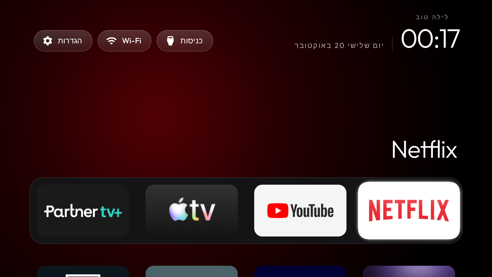
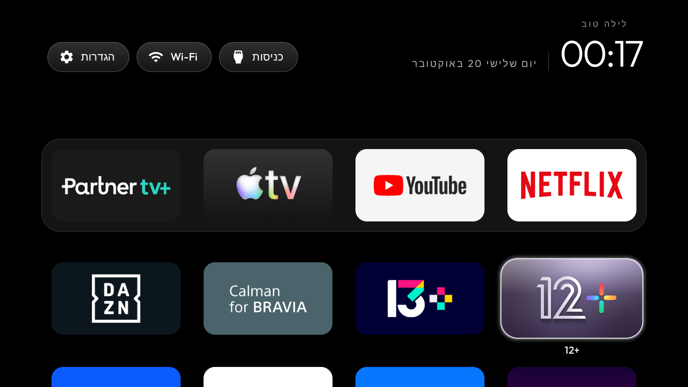
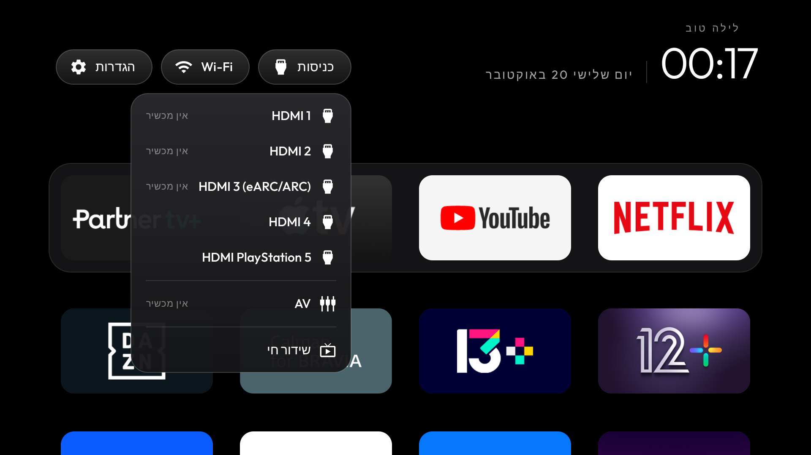
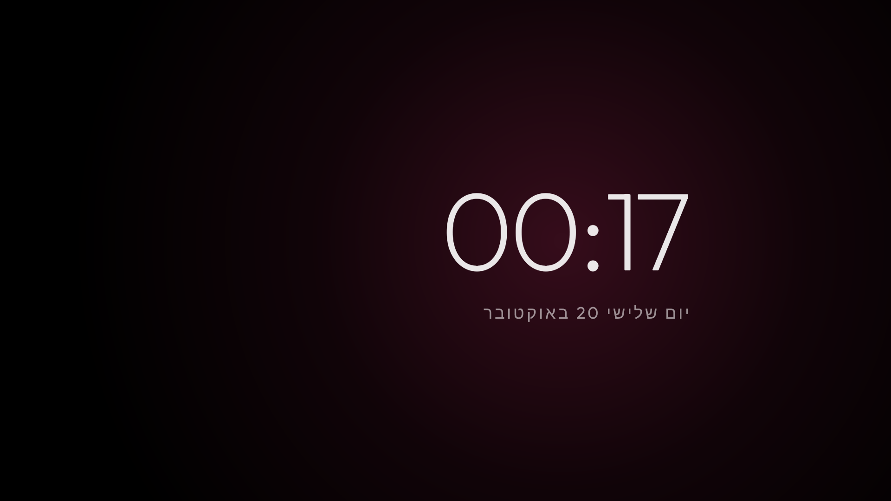

# The launcher

[Back to the README](../README.md#the-launcher)

A small native home screen for Android TV: **about 572 KB**, plain Java, built for TVs with 1 GB of RAM.
No blur, no video, no network permission, no background services. This page has the details the
README leaves out: settings, languages, remote keys and building it yourself. Every key a theme can
set is in [`themes/README.md`](../themes/README.md#keys), and the opt-in switches with their
screenshots are in [`docs/switches.md`](switches.md).

## Which TVs

The **TV** needs Android 8.0 (API 26) or newer: `minSdk` is a compile-time floor in
[`launcher/app/build.gradle`](../launcher/app/build.gradle), and the install script asks the TV for
`ro.build.version.sdk` before it builds, so an older set is told both numbers instead of failing at
`pm install` (see [Troubleshooting](TROUBLESHOOTING.md) for what is left on such a set).

## Build it yourself

It needs JDK 17 and Android SDK platform 34. On macOS: `brew install openjdk@17 android-commandlinetools`
and `sdkmanager "platforms;android-34" "build-tools;34.0.0"`. On Linux the install script finds
`~/Android/Sdk` and the `java` on your PATH.

## Configure

[`config.xml`](../launcher/app/src/main/res/values/config.xml) sets:

- the dock order, hidden apps and the Live TV package;
- columns (tiles shrink from 5 up) and rows under the dock;
- an optional VPN app for the network pill;
- `reduced_motion`, for TVs whose GPU cannot keep up.

Themes set the same keys plus a background colour and a wallpaper.

## Launcher settings and the default home

Click **Settings** for the TV's own settings. Hold OK on it for its menu:

- **Launcher settings**. With `launcher_settings_button` a click opens those instead, and the menu
  leaves the row out.
- **Native settings**, where the TV ships a settings app of its own beside Android's - Xiaomi China,
  TCL/FFALCON and Fire OS are in `settings_fallback_components` - because that app holds pages
  Android's has no row for, such as Xiaomi's Account & Security with the ADB switch.
- **Children's mode: schedule**: allowed hours, a daily limit, extra time, the parents' PIN, and phone control over
  Wi-Fi with a QR code.
- **Check and set up**: Home, the helper service, usage access, a settings backup file and the first-run wizard.
- **Watch next**, off by default: the cards apps publish, shown as posters, after you allow reading them. Once on and
  with cards to show, they are Home's first page: the focused card's title large, a row of posters and three dots
  that say the apps are one press down. Down shows the usual Home, Up from the first row of tiles brings the page back,
  and Up on the page reaches the top buttons.
- **Sleep timer**: each press steps off, 15, 30, 60 or 90 minutes. The TV goes to standby at the end, after a
  warning a minute before that any remote key answers with another 15 minutes.
- **Module cards**, with `module_cards`.
- **Edit dock**, with `dock_row`.
- **Reorder apps**: OK picks an app up, the arrows move it, Back places it, and Back again finishes.
  With `tile_menu` (on by default since 3.3), holding OK on a tile offers **Move**, which picks that app up straight away.
- **Restart…** while `HomeKeyService` runs, which opens the system power menu (a launcher may not
  restart the TV itself).

The launcher's own page has these rows, top to bottom:

- **Reorder apps**, only with `launcher_settings_button`, the same as the menu's.
- **Apps per row** 4, 5, 6 or 7; **Rows below dock** 0 to 3, how many rows of tiles stay visible under the
  dock band; **Dock band opacity** 100%, 70%, 50% or 30%. The last two only do anything while the dock is
  its own row (`dock_row`, on by default).
- **Clock**: **System** follows the TV's 12- or 24-hour setting; **12-hour** or **24-hour** sets the launcher's
  clocks (Home and the clock screensaver) to that, whatever the TV uses (`clock_format` in a theme).
- **Language**: the TV's own, or one from the list on GitHub (see [Languages](#languages)); it applies to the launcher alone.
- **Phone and cloud**: the cloud link for control from outside the home network, off by default (see [Phone and cloud](#phone-and-cloud)).
- **Wallpaper**: one picture from the theme's collection (or its `wallpaper.jpg`), **None**, or **Theme
  default**. A pick holds that picture and stops the rotation until you choose Theme default, press
  Follow theme, or push the theme again.
- **Animations** on or off, and **Advanced effects** (tile lift, icon zoom and smooth ambient-colour
  transitions; they may use more memory) once animations are on.
- **Open on start**, only with `open_on_start_choice`: Off, or an app that opens instead of Home the first
  time Home comes up after the TV starts. Once per boot, so Home and Back still reach the launcher.
- **Follow theme (reset on-TV choices)**, which clears every choice above. Pushing or resetting a theme
  clears them too.
- **Choose default home** opens Android's home picker, and **TV system settings** the TV's own settings
  page.

**Change the default home:** Launcher settings and the optional Default-home tile
(`show_home_settings_shortcut`) open Android's home picker. Choose the original launcher to stop using
CleanYourTV as Home, or CleanYourTV to return. The original launcher must be enabled; if the install
script disabled it, run the [restore script](../README.md#restoring-your-tv) first. Some TVs provide no
home picker.

## Languages

English, German, Danish, Spanish, Latin American Spanish, Catalan, French, Russian, Serbian (Latin), Polish, Czech, Italian, Portuguese,
Turkish, Arabic, Hebrew, Simplified Chinese, Traditional Chinese (Taiwan), Thai, Finnish, Vietnamese,
Bangla, Indonesian, Norwegian Bokmål, Swedish, Dutch, Uzbek (Latin), Ukrainian, Korean and Asturian. The launcher follows the TV's language. Launcher settings has a **Language** row that sets it for the launcher
alone, on any Android version: it lists the languages in [`languages.json`](../languages.json), a file on GitHub that
grows as translations are added (the list is read when the dialog opens, kept for when the TV is offline, and falls
back to what the installed build holds). A language that is listed but not yet in the installed build says so and waits
for an update. A theme can point the list elsewhere with `languages_url` (an `https` address, or empty to stay
offline) and can set a default with `locale`; the choice made on the TV wins over the theme's. Android 13+ can also set
it from adb: `tools/tv.py 'cmd locale set-app-locales com.gathin.tvhome --locales ca'`.

Hebrew mirrors the layout:

- menu buttons on the left, date and clock on the right with the greeting above;
- dock and app rows starting on the right, with matching remote navigation;
- the input selector's icons and labels on the right;
- dates with the month prefix ב (for example, 19 באוקטובר).

|  |  |
|---|---|
|  |  |

The Clock screensaver right-aligns its date and time. Russian covers every screen, including race
weekends, festival greetings and the Shamsi date. Other languages keep their original layouts.

## Module cards

Any TV app can declare its own tile (label, caption, glow). The launcher asks you once per app, keeps it
hidden by default, and remembers the answer for that app's signing key and card name. Hold OK on Settings
and choose Module cards to change your mind. How to make one: [`docs/modules.md`](modules.md); the
contract: [`docs/specs/card.md`](specs/card.md). Ready-made ones are in [`addons/`](../addons/), and
[cleanyour.tv/addons](https://cleanyour.tv/addons) shows the themes, switches and add-ons together.

## Clock screensaver

Pick "Clock" in the TV's screensaver settings, or over ADB:

```bash
tools/tv.py 'settings put secure screensaver_components com.gathin.tvhome/.ClockDream; settings put secure screensaver_enabled 1'
```

## Remote keys

- An optional accessibility service keeps the remote's **Input** button working on Google TV
  (`INPUT_KEY_SERVICE=1` at install).
- It can bring back other buttons only the stock launcher answered, such as the **YouTube** button
  (`app_keys` and `input_key_keycodes`, in config.xml or a theme; `HOME_KEY_SERVICE=1` reads `app_keys` too).
- A `hold:` prefix on an `app_keys` entry gives that button a second app: a normal press opens the
  unprefixed app, holding for half a second opens the hold one (by keycode or `hold:scan:...`). An entry can
  name an activity (`package/.Activity`), such as an add-on's quick bar, instead of the app's launcher entry.
  A `front:` prefix sets what a tap opens while that button's own app is already in front (`HomeKeyService`
  only).
- In place of an app, an `app_keys` entry can name an action: `back`, `home`, `recents`, `mute`, `sleep`
  (standby, Android 9 and later), `sleeptimer` (steps a sleep timer through off, 15, 30, 60 and 90 minutes; a
  warning shows a minute before, and a remote key answers it with another 15), `screensaver`, `settings`, `wifi`, `library` (Home with the App library
  open, for a remote's Apps button; needs `app_library`) or `ignore` (the button does nothing), so a spare
  colour button can mute the TV or, held, put it in standby.
- `HOME_KEY_SERVICE=1` also fixes sticks whose Home key sends ALL_APPS, and opens Settings from the remote's
  **gear** button, even one Android does not map (scancodes or keycodes in config.xml).
- With `settings_key_panel` the gear opens a [small quick settings panel](quick-settings-panel.jpg)
  over Home or any app: TV settings, Display, Network, Apps, Launcher settings and the Sleep timer.
- `quick_menu_scancode` (a theme key, `HOME_KEY_SERVICE=1`; a number, or a list such as `[561, 233]` for a TV
  with two remotes, the IR one sends the gear as 561 and the Bluetooth one as 233) splits one button by taps while any app is in
  front: one tap does what the TV does for it (on a TCL BeyondTV2 the settings panel, 350 ms
  late), two quick taps open the sleep timer over the video: it shows the time left when one already runs, and Up and Down round that to the next choice (15, 30, 60, 90 or off). Key
  filtering is on only while an app other than Home is in front, because a filtered release held up on a busy
  TV makes Android repeat the press; try it with the real remote and set the key to 0 if a press repeats.

The full `app_keys` format is in the [`themes/README.md` keys table](../themes/README.md#keys).

## Navigation and artwork

Up and Down move one row. The top buttons never fall through to tiles, and Down from them returns to the
dock tile you came from. The last focused app is remembered, and installing or removing an app refreshes
the tiles while Home is open. App banners load at xhdpi or better, so low-density TV UIs do not downsample
them before the focus zoom.

## Support the project

About has a **Support the project** row when a donation link is set: OK opens a screen with a QR code for each
link and a note that support is voluntary and that the launcher sends nothing itself. The links are
`support_url` (worldwide, Ko-fi) and `support_url_ru` (donors in Russia, whose cards the worldwide service does not
take) in `res/values/support.xml`; a theme can replace either in its `config.json`, and an empty value hides that
code. With both empty the row is not shown at all. A link must be a plain `https` address of at most 106 bytes. The
TV only draws the codes: it makes no request to those services (see [PRIVACY.md](PRIVACY.md)), and this screen needs no
network access at all.
## Phone and cloud

Launcher settings > **Phone and cloud** turns on the cloud link of [cloud-protocol.md](cloud-protocol.md): control of
the TV from a phone or a bot when you are not at home. It is **off** until a parent turns it on (with the parents' code
when one is set, in either direction), and the list of what the server learns is shown first. The TV only makes
outgoing HTTPS requests to the server (`https://tv.secondoffice.ru` by default; a theme's `cloud_url` replaces it, and
only an `https` address is accepted, plain http to this machine only in a debuggable build). It registers once, keeps the
secret in the launcher's private storage, sends its state at start, on every lock change and every 60 seconds, and
long-polls for commands: `lock`, `unlock`, `message`, `pause`, `bonus` and `power_off`. The TV decides: a command that has
expired, or arrives with the switch off, is refused, a bonus needs the schedule to be on, and an `unlock` does not lift the
schedule's block. The screen shows a six-digit pairing code and a QR code for it (`cloud_bot` in a theme or in
`res/values/cloud.xml` names a Telegram bot; without one the code opens the project's page). Turning the switch off deletes
this TV's data on the server and the secret here.

## Family features

The children's mode, the family message and phone control talk to nothing outside the home network by
default. What is kept and what is sent is in [PRIVACY.md](PRIVACY.md); the optional cloud relay's wire format is
in [cloud-protocol.md](cloud-protocol.md), a draft that nothing in the launcher speaks yet.

A phone, a script or a chat bot controls the TV through the HTTP API the launcher serves on the home Wi-Fi
(`/api/*` for a paired phone, `/k/<token>/...` for a phone listed in the theme): state, lock and unlock, a message
on the screen, pause, power off with an optional delay, screen time and a settings backup. The pages the TV serves
to a phone are translated like the rest of the launcher. A Telegram bot is one such client; the bot itself is not
part of this repository.

## Tidy-up on events

Nothing polls. The launcher looks at the TV's memory when Home has been in front with no key pressed for three
minutes (one timer, restarted by each key), when the screen goes off, and when Android asks apps to give memory back.
If the swap is nearly used up or little RAM is left, it closes the background processes of the apps (never the one
on screen, an app playing in a foreground service, the launcher or the VPN app), at most once in 20 minutes. When
`vpn_app` is set and its VPN is lost, four minutes later, with Home in front and quiet, it starts that app (once in
30 minutes) and returns to Home. Everything is logged under the tag `Sanitizer`. `"sanitizer": false` in the theme
turns it off.
